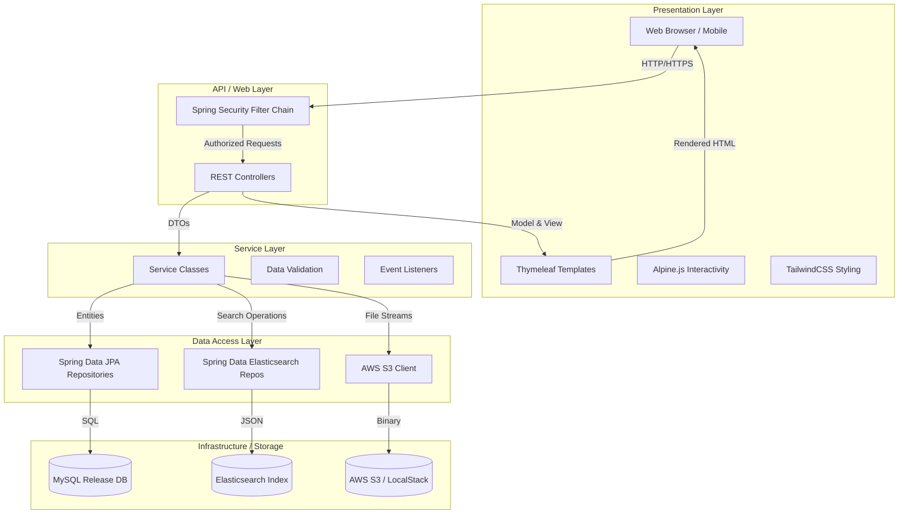
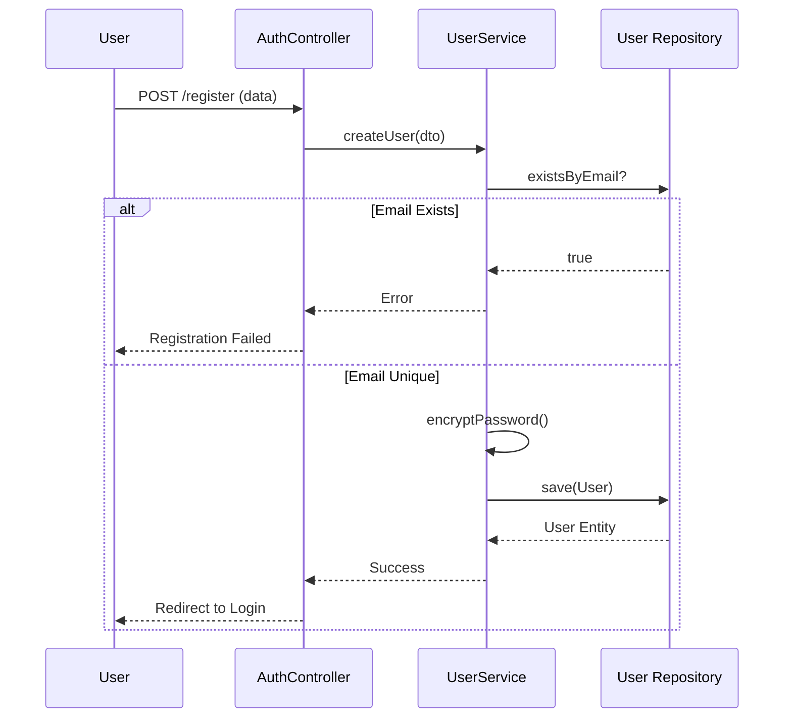
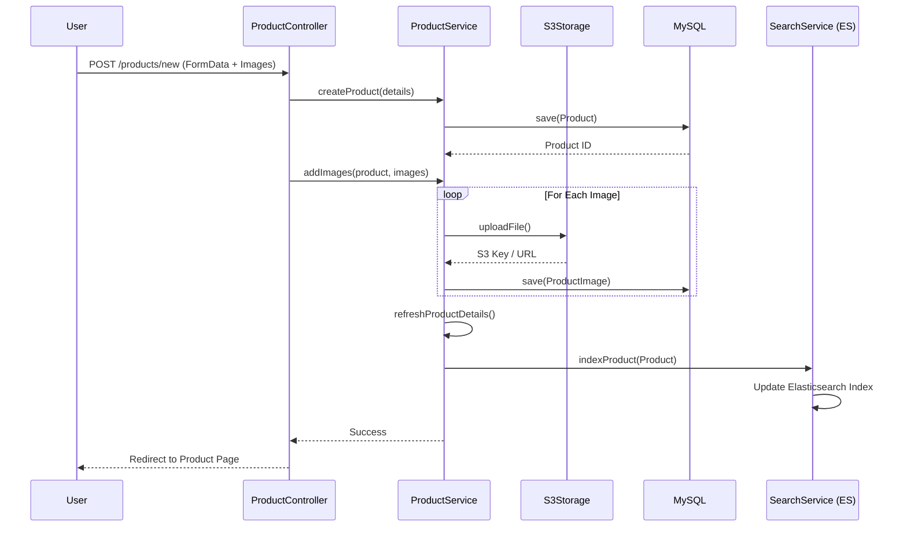
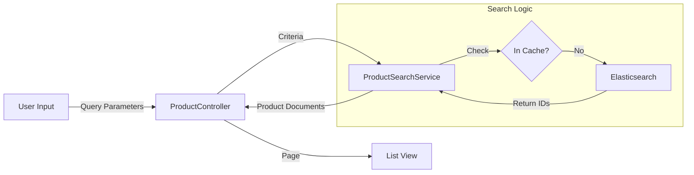
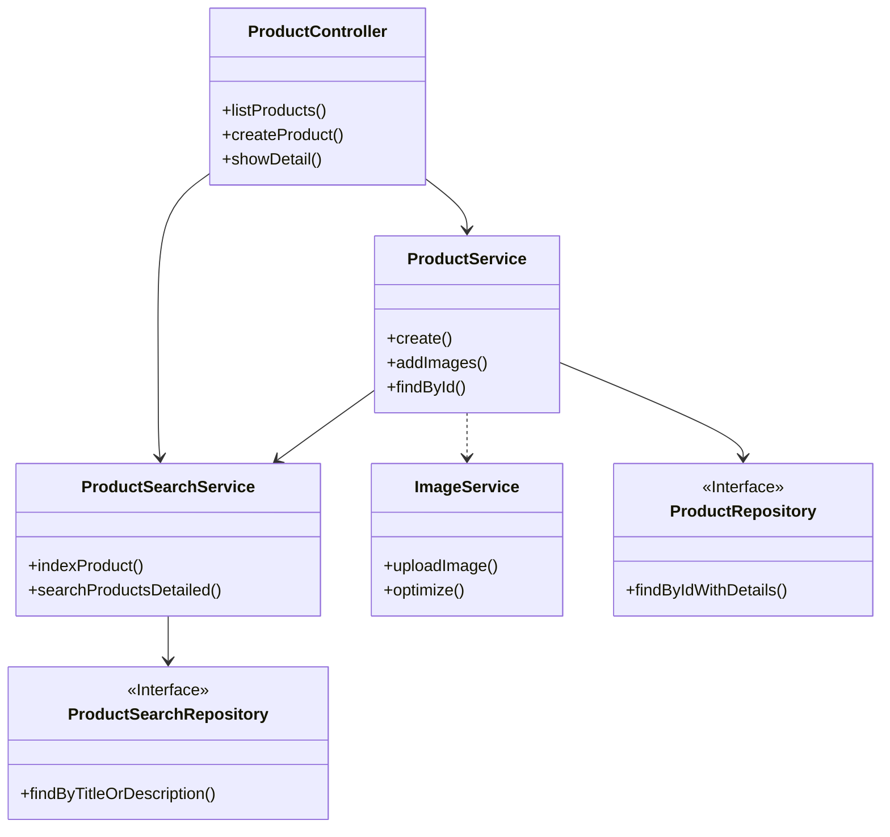
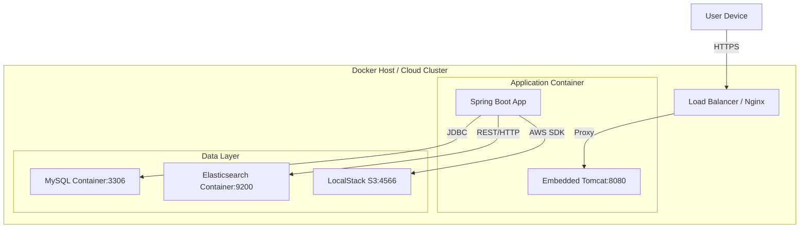

# Oudekenis Marketplace - Technical Documentation

## 1. System Overview

**Oudekenis** is a full-stack e-commerce marketplace application built with Spring Boot. It serves as a platform for users to buy and sell pre-loved items, similar to Ouedkniss. The application provides a seamless user experience for listing products, searching with advanced filters, real-time messaging, and managing user profiles.

### Key Features
*   **User Management**: Secure registration, authentication, and profile management with avatar support.
*   **Product Listings**: Users can create detailed product listings with multi-image uploads (stored in S3/LocalStack) and rich descriptions.
*   **Advanced Search**: High-performance search and filtering (Category, Price, Condition) powered by Elasticsearch.
*   **Interactive UI**: Responsive frontend built with Thymeleaf, TailwindCSS, and Alpine.js, featuring Dark Mode support.
*   **Messaging System**: Integrated chat functionality allowing buyers and sellers to communicate directly about listings.
*   **Wishlist**: Ability for users to "like" and save products for later.

## 2. System Architecture

The system follows a classic **Layered Architecture** pattern, ensuring separation of concerns and maintainability.

## 3. System Flow Diagrams

### 3.1 User Authentication Flow

### 3.2 Product Listing & Indexing Flow
This flow demonstrates the dual-write consistency between the Database and Search Index.

### 3.3 Search & Filtering Flow

## 4. Component Architecture

The application is structured logically by feature (Domain-Driven Design influence).

## 5. Deployment Architecture

The system is designed to be containerized and deployed in a distributed environment.

