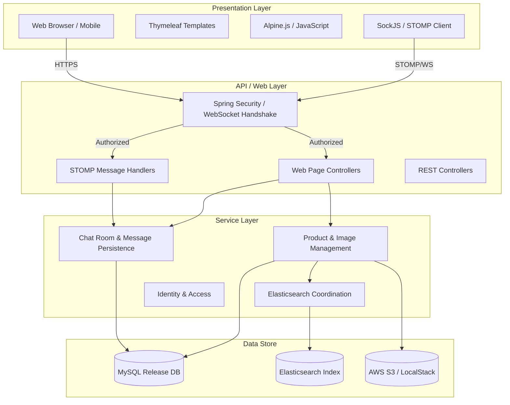
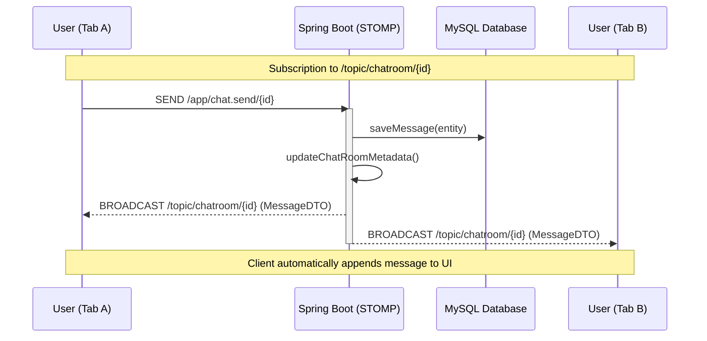
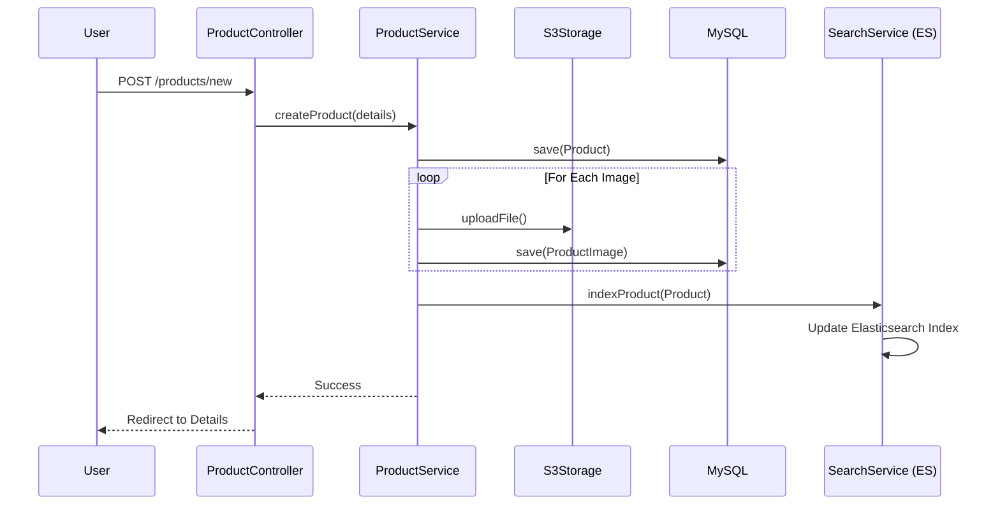
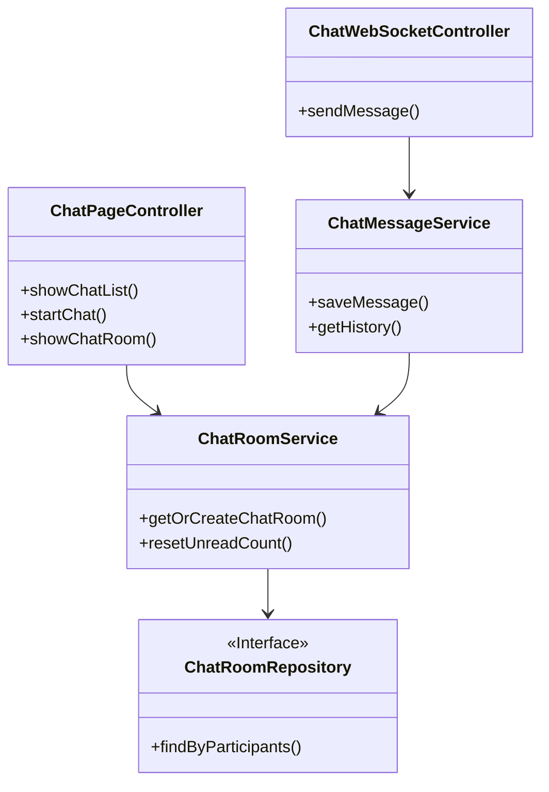
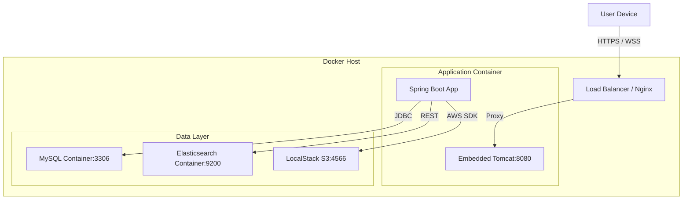

# Oudekenis Marketplace - Technical Documentation

## 1. System Overview

**Oudekenis** is a full-stack e-commerce marketplace application built with Spring Boot. It serves as a platform for users to buy and sell pre-loved items, similar to Ouedkniss. The application provides a seamless user experience for listing products, searching with advanced filters, real-time messaging, and managing user profiles.

### Key Features
*   **User Management**: Secure registration, authentication, and profile management.
*   **Product Listings**: Detailed listings with multi-image uploads (S3/LocalStack storage).
*   **Advanced Search**: High-performance filtering powered by Elasticsearch.
*   **Integrated UI**: Responsive frontend with Thymeleaf, TailwindCSS, and Alpine.js.
*   **Real-Time Chat**: Innovative WebSocket-powered chat tied directly to product listings.

## 2. System Architecture

The system follows a **Layered Architecture** with a clear modular boundary for the Chat system.

## 3. System Flow Diagrams

### 3.1 Real-Time Messaging Flow (WebSocket)

### 3.2 Product Listing & Indexing Flow

## 4. Component Architecture (Chat Module)

The application is structured logically by feature.

## 5. Deployment Architecture

