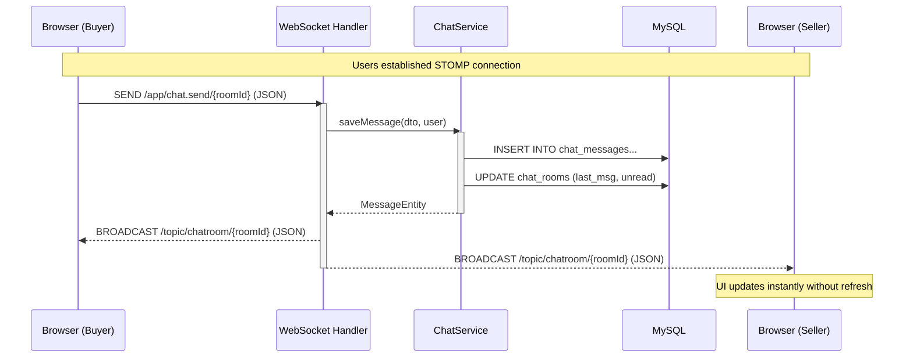
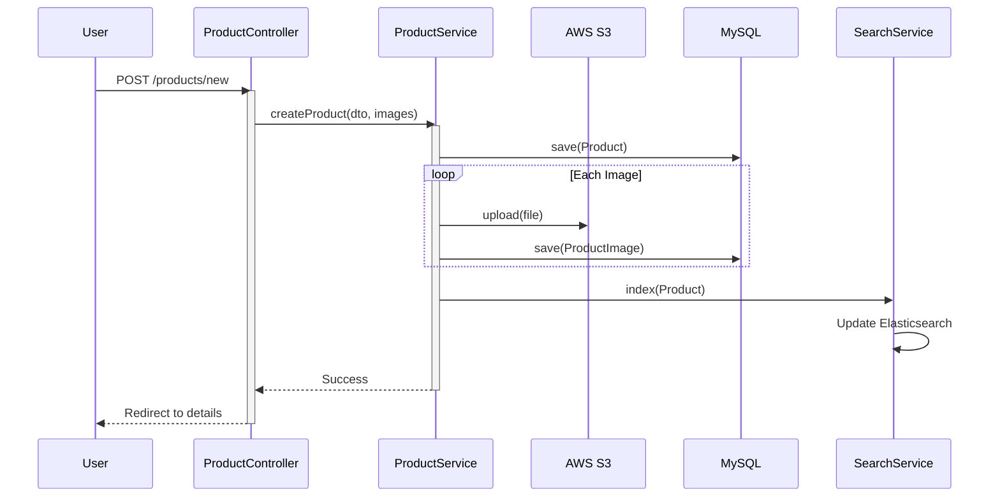
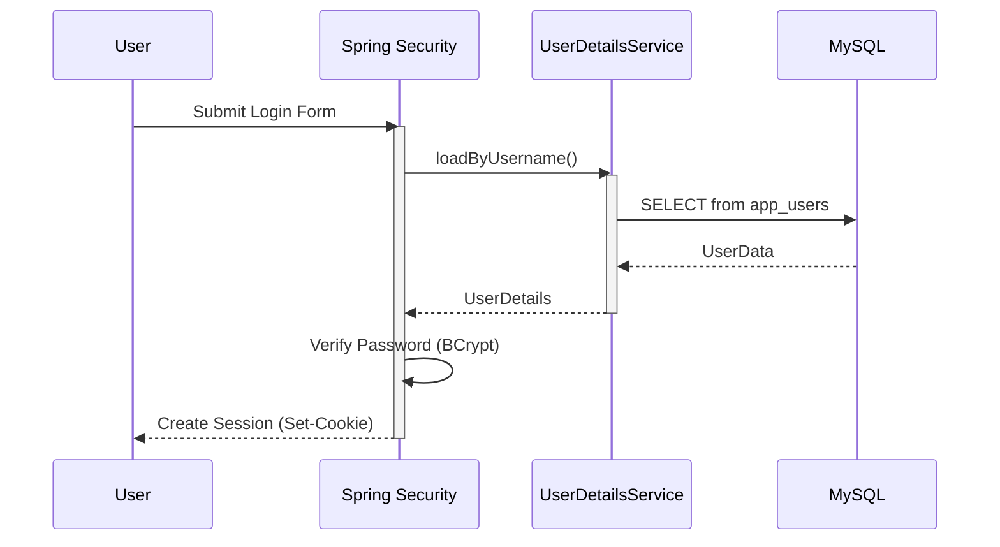
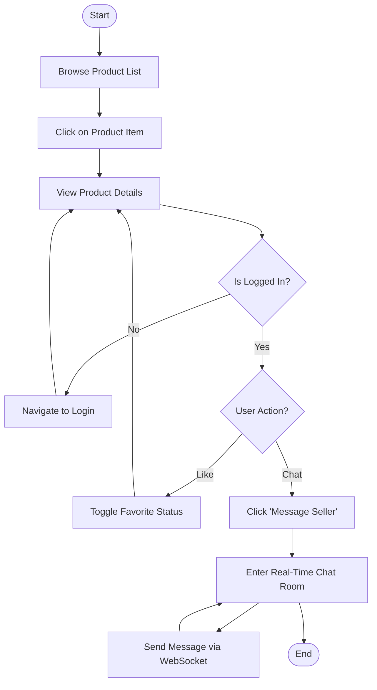

# Oudekeniss Marketplace - UML Diagrams

## 1. Use Case Diagram

The following diagram illustrates the primary actors and their interactions with the system.

```mermaid
usecaseDiagram
    actor "Guest" as Guest
    actor "User" as User
    actor "Seller" as Seller

    package "Oudekeniss Marketplace" {
        usecase "Browse Products" as UC1
        usecase "Search Items" as UC2
        usecase "View Details" as UC3
        
        usecase "Authenticate" as UC4
        usecase "Manage Dashboard" as UC5
        usecase "Real-Time Chat" as UC6
        usecase "Favorite Item" as UC7
        
        usecase "Post Listing" as UC8
        usecase "Update Listing" as UC9
    }

    Guest --> UC1
    Guest --> UC2
    Guest --> UC3
    Guest --> UC4

    User --|> Guest
    User --> UC5
    User --> UC6
    User --> UC7

    Seller --|> User
    Seller --> UC8
    Seller --> UC9

    UC8 ..> UC3 : <<leads to>>
```

## 2. Sequence Diagrams

### a) Real-Time Messaging Sequence (WebSocket)


### b) Product Listing Sequence


### c) User Authenticated Flow (SSO/Session)


## 3. Activity Diagram

### Product Engagement Workflow

