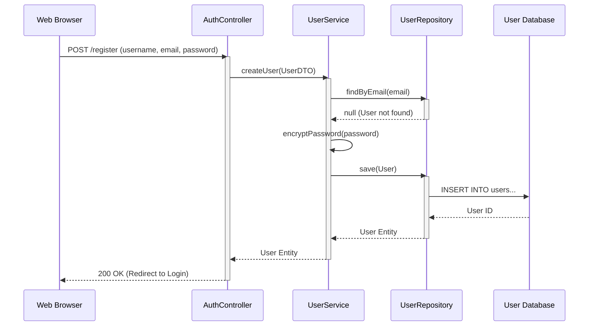
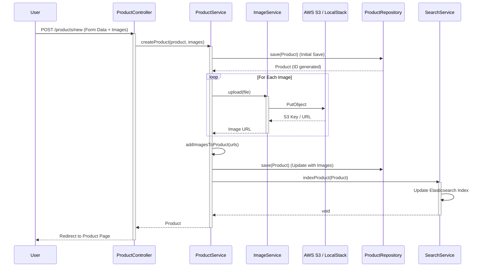
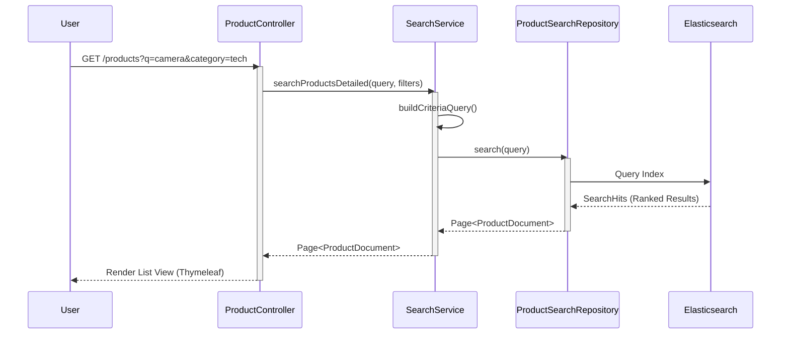
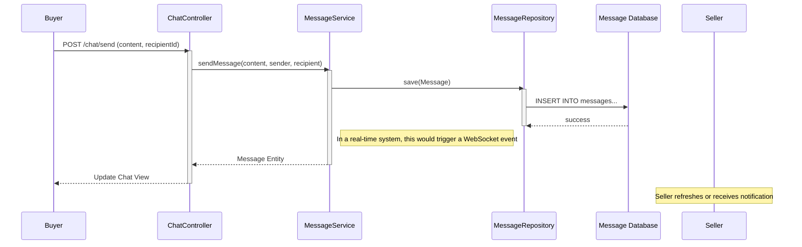
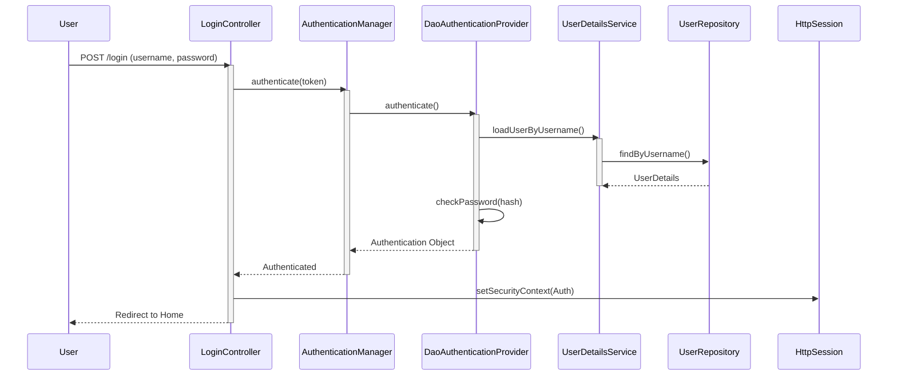
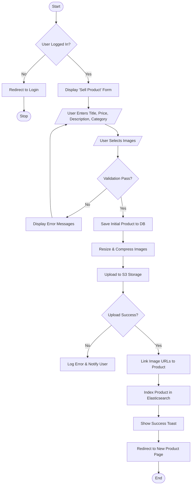

# Oudekeniss Marketplace - UML Diagrams

## 1. Use Case Diagram

The following diagram illustrates the primary actors and their interactions with the system.

```mermaid
usecaseDiagram
    actor "Guest User" as Guest
    actor "Registered User" as User
    actor "Seller" as Seller
    actor "Administrator" as Admin

    package "Oudekeniss Marketplace" {
        usecase "Search Products" as UC1
        usecase "View Product Details" as UC2
        usecase "Filter by Category/Price" as UC3
        
        usecase "Register / Login" as UC4
        usecase "Manage Profile" as UC5
        usecase "Send Message" as UC6
        usecase "Add to Favorites" as UC7
        
        usecase "Create Listing" as UC8
        usecase "Upload Photos" as UC9
        usecase "Edit/Delete Listing" as UC10
        
        usecase "Moderate Listings" as UC11
        usecase "Manage Users" as UC12
        usecase "View Statistics" as UC13
    }

    Guest --> UC1
    Guest --> UC2
    Guest --> UC3
    Guest --> UC4

    User --|> Guest
    User --> UC5
    User --> UC6
    User --> UC7

    Seller --|> User
    Seller --> UC8
    Seller --> UC9
    Seller --> UC10

    Admin --> UC11
    Admin --> UC12
    Admin --> UC13

    UC8 ..> UC9 : <<include>>
```

## 2. Sequence Diagrams

### a) User Registration Sequence


### b) Product Listing Creation Sequence


### c) Product Search Sequence


### d) Messaging Sequence


### e) User Authentication Sequence


## 3. Activity Diagram

### Product Posting Workflow
This diagram represents the flow of creating a new product listing.


