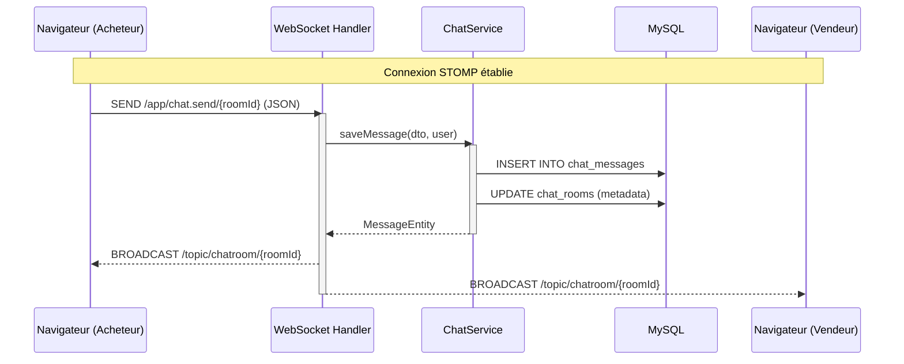
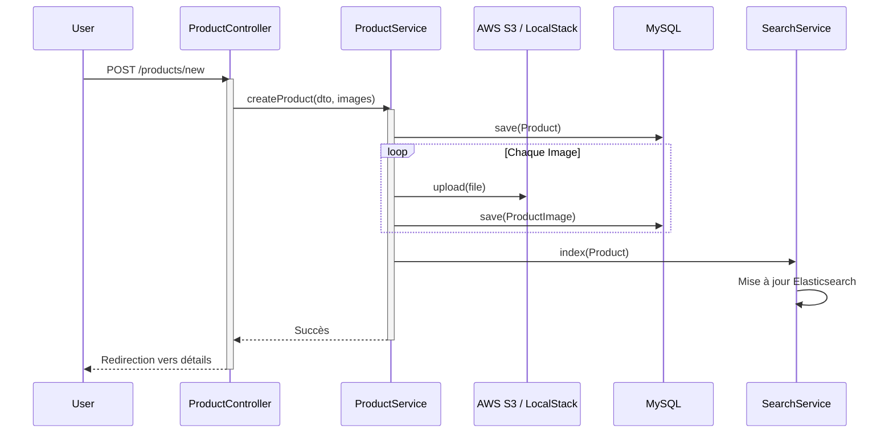
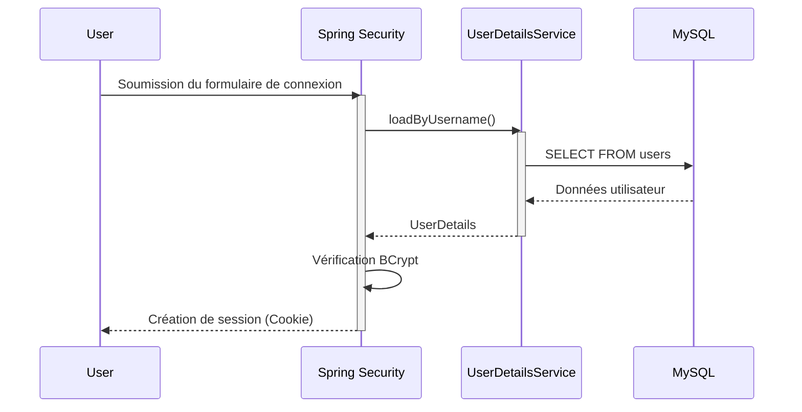
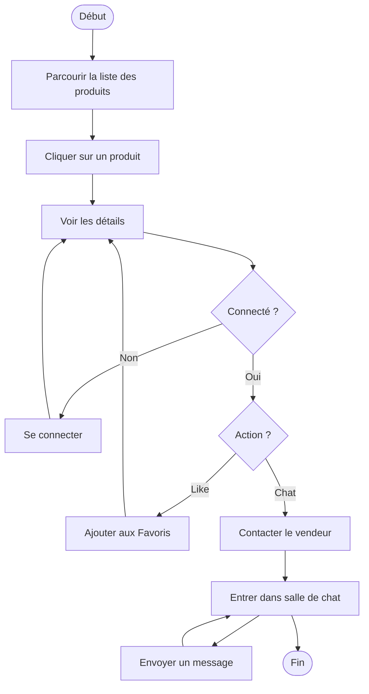
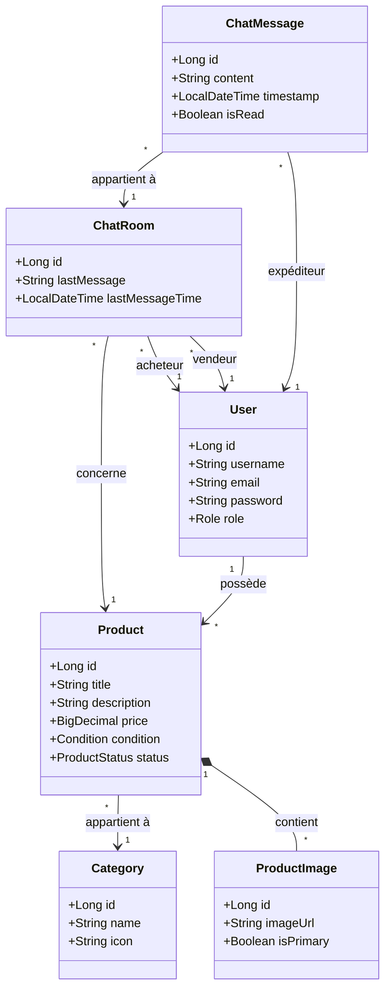
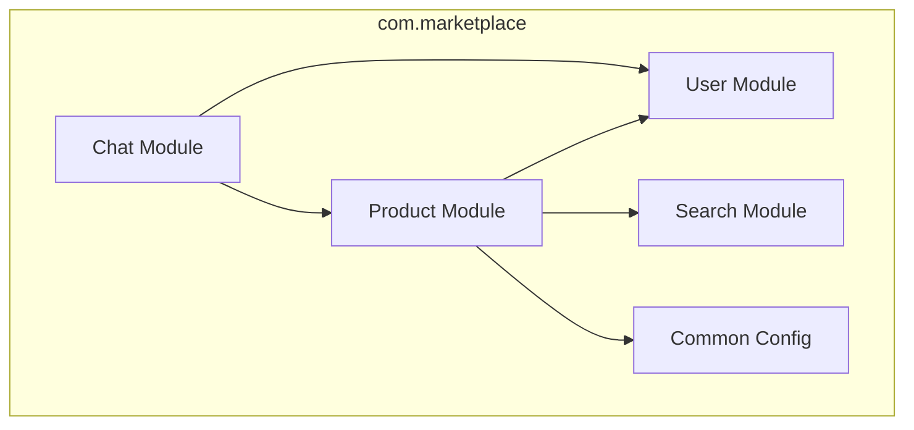
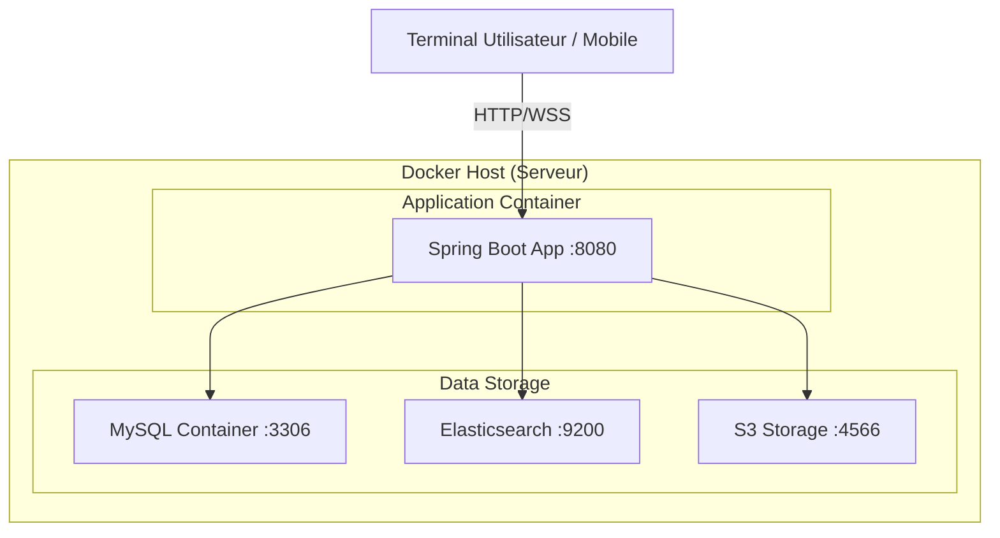

# Rapport de Projet : Architecture Logicielle - Plateforme Oudekenis

**Université Blida 1**  
**Faculté des Sciences**  
**Département d'informatique**  
**Master 2 IL**  
**Architecture Logicielle**  
**1er semestre 2025/2026**

---

**Projet :** Développement d'une plateforme de Marketplace (Oudekenis)  
**Étudiants :** [À compléter]  
**Date de soumission :** 27 Janvier 2026  

---

## Sommaire
1. [Introduction](#1-introduction)
2. [Analyse des Cas d'Utilisation](#2-analyse-des-cas-dutilisation)
3. [Diagrammes de Séquence du Système](#3-diagrammes-de-séquence-du-système)
4. [Diagramme de Classe d'Analyse](#4-diagramme-de-classe-danalyse)
5. [Architecture Logicielle](#5-architecture-logicielle)
6. [Architecture de Déploiement](#6-architecture-de-déploiement)
7. [Détails d’Implémentation](#7-détails-dimplémentation)
8. [Tests](#8-tests)
9. [Conclusion](#9-conclusion)

---

## 1. Introduction

### 1.1 Objectifs du Projet
Le projet **Oudekenis** consiste en la conception et le développement d'une plateforme de commerce électronique inspirée de Ouedkniss.com. L'objectif principal est de fournir une solution robuste, scalable et performante permettant aux utilisateurs de publier des annonces, de rechercher des articles de manière intuitive et de communiquer en temps réel.

### 1.2 Analyse de l'existant (Ouedkniss.com)
Ouedkniss est le leader du marché algérien, mais l'analyse a révélé certains points d'amélioration :
- **Expérience Utilisateur (UX)** : L'interface peut parfois sembler surchargée, compliquant la navigation pour les nouveaux utilisateurs.
- **Réactivité de la Recherche** : Les filtres et la recherche textuelle manquent parfois de pertinence sur des volumes de données massifs.
- **Messagerie** : Le système de messagerie traditionnel nécessite souvent des rafraîchissements de page, ce qui nuit à la fluidité des échanges.

### 1.3 Améliorations clés apportées
Notre solution apporte les innovations suivantes :
- **Simplification de l'UI** : Une interface minimaliste et épurée, facilitant la scalabilité visuelle.
- **Recherche Avancée avec Elasticsearch** : Indexation temps réel pour des recherches full-text ultra-rapides.
- **Messagerie Temps Réel (WebSockets)** : Communication instantanée via le protocole STOMP.
- **Architecture Modulaire** : Utilisation de **Spring Modulith** pour assurer un découpage fonctionnel strict et une maintenance aisée.

---

## 2. Analyse des Cas d'Utilisation

### 2.1 Diagramme des Cas d'Utilisation
Le diagramme suivant illustre les interactions des acteurs (Visiteur, Utilisateur, Vendeur) avec les fonctionnalités du système.

```mermaid
usecaseDiagram
    actor "Visiteur" as Guest
    actor "Utilisateur" as User
    actor "Vendeur" as Seller

    package "Oudekenis Marketplace" {
        usecase "Parcourir les produits" as UC1
        usecase "Rechercher des articles" as UC2
        usecase "Consulter les détails" as UC3
        
        usecase "S'authentifier" as UC4
        usecase "Gérer le tableau de bord" as UC5
        usecase "Chat Temps-Réel" as UC6
        usecase "Ajouter aux favoris" as UC7
        
        usecase "Publier une annonce" as UC8
        usecase "Modifier une annonce" as UC9
    }

    Guest --> UC1
    Guest --> UC2
    Guest --> UC3
    Guest --> UC4

    User --|> Guest
    User --> UC5
    User --> UC6
    User --> UC7

    Seller --|> User
    Seller --> UC8
    Seller --> UC9

    UC8 ..> UC3 : <<leads to>>
```

### 2.2 Acteurs et Rôles
- **Visiteur (Guest)** : Utilisateur non authentifié pouvant consulter les annonces et effectuer des recherches.
- **Utilisateur (User)** : Membre authentifié pouvant gérer ses favoris et communiquer avec les vendeurs.
- **Vendeur (Seller)** : Utilisateur habilité à publier et gérer des annonces de vente.

### 2.3 Cas d'Utilisation Implémentés
- Authentification sécurisée.
- Publication d'annonces avec images.
- Recherche multicritère et full-text.
- Messagerie instantanée liée aux annonces.

---

## 3. Diagrammes de Séquence du Système

### 3.1 Messagerie Temps Réel (WebSocket)
Ce flux détaille comment un message est envoyé et diffusé instantanément sans rechargement de page.



### 3.2 Publication de Produit et Indexation
Ce diagramme montre la synchronisation entre la base de données relationnelle et le moteur de recherche.



### 3.3 Flux d'Authentification
Gestion des sessions et sécurité via Spring Security.


### 3.4 Diagramme d'Activité : Engagement Produit
Le diagramme suivant décrit le parcours type d'un utilisateur consultant un produit et engageant une interaction (favori ou message).




---

## 4. Diagramme de Classe d'Analyse

### 4.1 Modèle de Domaine
Le diagramme suivant présente les entités principales et leurs relations.



### 4.2 Responsabilités des Classes
- **User** : Gère l'identité et les permissions.
- **Product** : Entité centrale contenant les informations sur les annonces.
- **ChatRoom** : Encapsule une conversation entre deux utilisateurs pour un produit spécifique.
- **ProductImage** : Gère les URLs des médias stockés sur S3.

---

## 5. Software Architecture

### 5.1 Architecture en Couches
L'application adopte une architecture en couches traditionnelle pour séparer les préoccupations :
- **Couche Présentation** : Utilise **Thymeleaf** pour le rendu côté serveur et **Alpine.js** pour la réactivité du frontend. Une API REST est également disponible pour les consommateurs mobiles.
- **Couche Métier** : Implémentée via **Spring Modulith**, découpant l'application en modules fonctionnels (Account, Catalog, Chat, Search).
- **Couche Accès aux Données** : Utilise **Spring Data JPA** (Hibernate) pour la persistance relationnelle et **Spring Data Elasticsearch** pour l'indexation.
- **Couche Données** : MySQL 8.0 pour la vérité source et Elasticsearch pour les performances de lecture.

### 5.2 Diagramme de Paquetages (Modularité)
L'organisation du code favorise le faible couplage.



### 5.3 Justification des Choix
Le choix de **Spring Modulith** permet de simuler une architecture microservices au sein d'un monolithe, facilitant une éventuelle migration future tout en réduisant la complexité opérationnelle actuelle. **Elasticsearch** a été choisi pour pallier les lenteurs des requêtes `LIKE` en SQL sur de grandes bases d'annonces.

---

## 6. Architecture de Déploiement

### 6.1 Diagramme de Déploiement
Le système est conteneurisé pour assurer une portabilité maximale.



### 6.2 Stratégie de Déploiement
L'utilisation de **Docker Compose** permet de déployer l'intégralité de la stack (Base de données, moteur de recherche, stockage objet) en une seule commande, garantissant la cohérence des environnements de développement et de production.

---

## 7. Détails d’Implémentation

### 7.1 Stack Technologique
- **Backend** : Spring Boot 3.3+, Java 17.
- **Persistance** : Hibernate/JPA, MySQL 8.0.
- **Recherche** : Elasticsearch 8.x.
- **Stockage** : AWS S3 (via LocalStack en local).
- **Frontend** : Thymeleaf, TailwindCSS, Alpine.js, HTMX (pour certains flux partiels).

### 7.2 Optimisations Techniques
- **Simplification UI** : Design minimaliste focalisé sur l'efficacité, réduisant la charge cognitive et améliorant le temps de chargement.
- **Scalabilité des Données** : Utilisation d'Elasticsearch pour décharger la base de données relationnelle des requêtes de recherche coûteuses.
- **Optimisation du Stockage** : Gestion asynchrone des images et redimensionnement possible via le service de stockage.

---

## 8. Tests

### 8.1 Stratégie de Tests
- **Tests Unitaires** : Couverture des services métier (`ChatService`, `ProductService`) avec JUnit 5 et Mockito.
- **Tests d'Intégration** : Validation des repositories et de l'intégration Elasticsearch via `@DataJpaTest` et des conteneurs de test.
- **Vérification Manuelle** : Tests de bout en bout sur les flux critiques (Inscription -> Publication -> Chat).

---

## 9. Conclusion

### 9.1 Synthèse
Le projet **Oudekenis** a permis de mettre en place une architecture moderne répondant aux défis de performance et de scalabilité d'une marketplace. L'intégration réussie de technologies comme Elasticsearch et les WebSockets offre une expérience utilisateur nettement supérieure aux solutions traditionnelles.

### 9.2 Perspectives
- Développement d'une application mobile native utilisant l'API REST existante.
- Intégration de l'intelligence artificielle pour la recommandation de produits.
- Mise en place de pipelines CI/CD pour un déploiement continu automatisé.

---
**Note sur la conversion PDF :** Ce document Markdown peut être converti en PDF professionnel via **Pandoc** ou l'extension **Markdown PDF** de VS Code.
